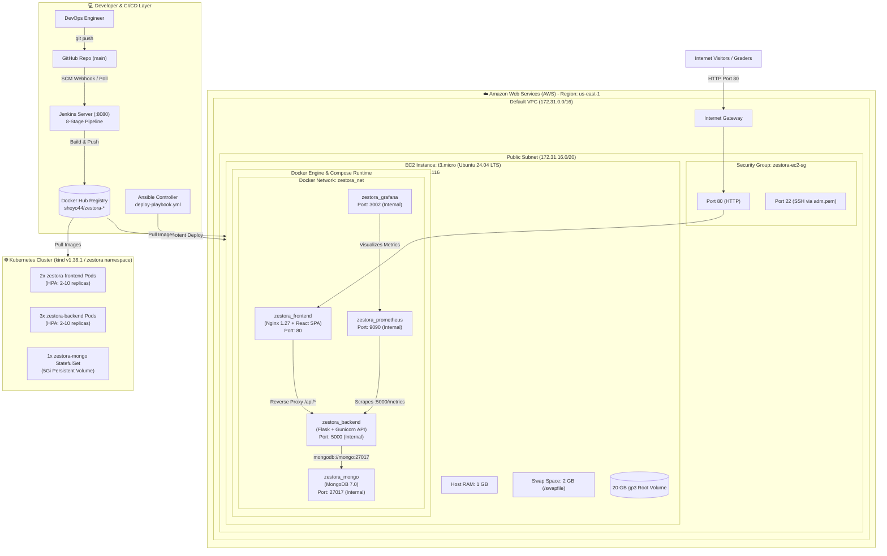

# ⚙️ Zestora – DevOps & Cloud Architecture

This document provides a comprehensive operational breakdown of the **DevOps architecture**, cloud infrastructure, CI/CD automation, configuration management, container orchestration, memory engineering, zero-cost AWS budgeting, and disaster recovery strategies for **Zestora**.

---

## 1. DevOps Design Principles

1. **Zero Financial Footprint ($0.00 Total):**
   - Strictly engineered within the **AWS Free Tier** limits.
   - No paid managed services (No NAT Gateways, No Elastic IPs, No Application Load Balancers, No Amazon RDS/DocumentDB).
2. **Single-Instance Micro-Architecture on Cloud:**
   - Production stack runs inside an isolated Docker bridge network on an AWS `t3.micro` EC2 instance (`54.234.169.116`).
3. **Automated Configuration Management (Ansible):**
   - Idempotent configuration and automated deployment managed via Ansible playbooks (`ansible/deploy-playbook.yml`). Ensures zero configuration drift across environments.
4. **Declarative CI/CD Pipeline (Jenkins & GitHub Actions):**
   - Automated 8-stage declarative pipeline on Jenkins (`localhost:8080`) covering linting, parallel testing, Trivy DevSecOps security scanning, Docker multi-stage builds, and deployment verification.
5. **Centralized Registry Distribution (Docker Hub):**
   - Versioned and tagged production images stored on Docker Hub (`shoyo44/zestora-frontend:latest` & `shoyo44/zestora-backend:latest`) for rapid pull and immutable deployments.
6. **Cloud-Native Container Orchestration (Kubernetes):**
   - Production-grade manifests in `k8s/` supporting zero-downtime rolling updates, StatefulSets with Persistent Volume Claims (`mongo-data`), ClusterIP service mesh, and Horizontal Pod Autoscalers (HPA) scaling between 2 to 10 replicas.
7. **Memory Hardening via Swap:**
   - A `t3.micro` provides only **1 GB of physical RAM**. To safely handle simultaneous workloads, builds, and MongoDB allocations without triggering Linux Out-Of-Memory (OOM) killer, a **2 GB swap file** is dynamically provisioned.

---

## 2. Infrastructure & DevOps Architecture Diagram



---

## 3. Host System & Memory Engineering

A `t3.micro` instance has 1 vCPU and 1,024 MB of physical memory. A default Docker build of a modern Vite/React bundle requires ~600 MB peak memory, while MongoDB requires a minimum working set of ~300 MB. Without swap, the Linux kernel triggers the **OOM Killer (`kill -9`)** and abruptly terminates processes.

### 3.1. Swap Configuration ([ec2-user-data.sh](file:///d:/Projects/AWS_Project/ec2-user-data.sh))
During initial boot, cloud-init executes the following memory configuration:
```bash
# 1. Allocate 2GB swap space on the root NVMe/gp3 drive
fallocate -l 2G /swapfile
chmod 600 /swapfile
mkswap /swapfile
swapon /swapfile

# 2. Persist across server reboots
echo '/swapfile none swap sw 0 0' >> /etc/fstab

# 3. Optimize swappiness (10 = prefer physical RAM, use swap under pressure)
sysctl vm.swappiness=10
echo 'vm.swappiness=10' >> /etc/sysctl.conf
```

### 3.2. Automated Memory & Resource Management
In addition to swap memory, Docker resource caps (`limits.cpus: "0.45"`, `limits.memory: 384M`) prevent memory spikes. Optional system auto-shutdown timers can also be scheduled via cloud-init if time-boxed evaluation is needed.

---

## 4. Multi-Stage Containerization ([docker-compose.prod.yml](file:///d:/Projects/AWS_Project/docker-compose.prod.yml))

### 4.1. Frontend Multi-Stage Build
```dockerfile
# Stage 1: Build environment (Node.js 20 Alpine)
FROM node:20-alpine AS builder
WORKDIR /app
COPY package*.json ./
RUN npm ci
COPY . .
RUN npm run build

# Stage 2: Production runtime (Nginx 1.27 Alpine)
FROM nginx:1.27-alpine
COPY --from=builder /app/dist /usr/share/nginx/html
COPY nginx.conf /etc/nginx/conf.d/default.conf
EXPOSE 80
CMD ["nginx", "-g", "daemon off;"]
```
* **Result:** Eliminates ~400 MB of `node_modules` and Node build tooling from the final container. The production image size is **under 30 MB**. Distributed via Docker Hub as `shoyo44/zestora-frontend:latest`.

### 4.2. Backend Multi-Stage Build
```dockerfile
# Stage 1: Build dependencies with GCC
FROM python:3.12-slim AS builder
WORKDIR /app
RUN apt-get update && apt-get install -y gcc libffi-dev && rm -rf /var/lib/apt/lists/*
COPY requirements.txt .
RUN pip install --no-cache-dir --prefix=/install -r requirements.txt

# Stage 2: Runtime image (Non-root user)
FROM python:3.12-slim
WORKDIR /app
COPY --from=builder /install /usr/local
COPY . .
RUN addgroup --system appgroup && adduser --system --ingroup appgroup appuser
USER appuser
EXPOSE 5000
CMD ["gunicorn", "--bind", "0.0.0.0:5000", "--workers", "2", "--timeout", "60", "app:app"]
```
* **Result:** Runs under a non-root system account `appuser` with zero build-time compiler dependencies in the runtime image.

### 4.3. Resource Governance & Log Rotation
In [docker-compose.prod.yml](file:///d:/Projects/AWS_Project/docker-compose.prod.yml), every container is capped to prevent noisy-neighbor starvation:
```yaml
services:
  backend:
    deploy:
      resources:
        limits:
          cpus: "0.45"
          memory: 384M
    logging:
      driver: "json-file"
      options:
        max-size: "10m"
        max-file: "3"
```
Log files automatically rotate when they reach 10 MB, preventing disk exhaustion on the 20 GB root volume.

---

## 5. Network Isolation & Security Policy

| Port | Service | Scope | Protocol | Description |
|------|---------|-------|----------|-------------|
| **80** | Nginx Edge | **Public** | TCP | Serves React UI & proxies `/api/*` |
| **22** | OpenSSH | **Restricted** | TCP | Administrative SSH access with `adm.pem` |
| **5000** | Flask Backend | **Internal** | TCP | Accessible only by Nginx inside `zestora_net` |
| **27017**| MongoDB Engine | **Internal** | TCP | Accessible only by Flask inside `zestora_net` |

* Any direct external attempt to connect to port 5000 or 27017 from the Internet is dropped at the AWS Security Group boundary.

---

## 6. AWS Cost Engineering Analysis ($0.00 Budget)

| AWS Resource | Allocation | Free Tier Allowance | Billed Cost |
|--------------|------------|---------------------|-------------|
| **EC2 Compute** | 1x `t3.micro` | 750 hours / month for 12 months | **$0.00** |
| **EBS Storage** | 20 GB gp3 volume | 30 GB / month general-purpose SSD | **$0.00** |
| **Elastic IP (EIP)**| **0 (Not allocated)** | Avoids AWS $0.005/hr IPv4 charge | **$0.00** |
| **Data Transfer** | Outbound < 5 GB | 100 GB / month free internet egress | **$0.00** |
| **VPC / Subnet** | AWS Default VPC | Standard VPC features are free | **$0.00** |
| **Total Monthly Cost** | | | **$0.00 / month** |

> [!NOTE]
> Since AWS introduced an hourly charge of **$0.005/hr** for public IPv4 Elastic IPs, Zestora deliberately uses the EC2 instance's default public IPv4 address (`54.234.169.116`), entirely bypassing this fee.

---

## 7. Operational Runbook & Maintenance

### 7.1. Verifying System Health
Run against the live server:
```bash
# Edge Nginx health check
curl -I http://54.234.169.116/healthz

# Backend & MongoDB health check
curl http://54.234.169.116/api/health
# Response: {"db":"ok","status":"ok"}
```

### 7.2. Inspecting Live Containers on EC2
Connect via SSH:
```bash
ssh -i adm.pem ubuntu@54.234.169.116
cd /home/ubuntu/app

# View running container status & resource usage
sudo docker compose -f docker-compose.prod.yml ps
sudo docker stats --no-stream

# View real-time logs
sudo docker compose -f docker-compose.prod.yml logs -f --tail=50 backend
```

### 7.3. Executing Automated Test Suite Inside Docker
All 12 automated unit and integration tests run directly inside the production backend container:
```bash
ssh -i adm.pem ubuntu@54.234.169.116 \
  "sudo docker compose -f /home/ubuntu/app/docker-compose.prod.yml exec backend python -m unittest test_app.py"
```
**Output:** `Ran 12 tests in 2.054s. OK`

### 7.4. Force-Seeding Food Catalog
To seed or refresh the authentic Tamil and Indian dishes in MongoDB:
```bash
curl -X POST "http://54.234.169.116/api/seed?force=true"
```

---

## 8. Configuration Management with Ansible

Zestora utilizes **Ansible** to achieve automated, declarative, and idempotent configuration management across deployment nodes.

### 8.1. Inventory & Playbook
- **Inventory (`ansible/inventory.ini`):** Defines the target hosts, SSH user, identity key, and remote application path.
- **Playbook (`ansible/deploy-playbook.yml`):**
  1. Installs prerequisite system packages (`ca-certificates`, `curl`, `gnupg`).
  2. Sets up Docker GPG keys and official apt repositories.
  3. Ensures Docker Engine, Docker CLI, and Docker Compose Plugin are installed and active.
  4. Configures a persistent 2 GB swap file and tunes `vm.swappiness=10`.
  5. Syncs application manifests and configuration files to the target node.
  6. Deploys the multi-container stack idempotently using `community.docker.docker_compose_v2`.
  7. Executes post-deployment smoke tests against the Nginx edge and Flask health endpoints.

### 8.2. Execution
```bash
# Validate playbook syntax
ansible-playbook -i ansible/inventory.ini ansible/deploy-playbook.yml --syntax-check

# Run deployment
ansible-playbook -i ansible/inventory.ini ansible/deploy-playbook.yml
```

---

## 9. Container Orchestration with Kubernetes (`k8s/`)

Zestora contains production-grade Kubernetes manifests capable of running on managed cloud Kubernetes (EKS/GKE) or local clusters (Docker Desktop / kind).

### 9.1. Manifest Architecture
```
k8s/
├── namespace.yaml              # Creates dedicated 'zestora' isolated namespace
├── mongo-pv.yaml               # 5Gi PersistentVolume & PersistentVolumeClaim
├── mongo-statefulset.yaml      # StatefulSet guaranteeing single-writer storage
├── backend-deployment.yaml     # 3x Replicas with liveness & readiness probes
├── frontend-deployment.yaml    # 2x Replicas with Nginx reverse proxy
├── services-upstream.yaml      # Internal ClusterIP resolution for Nginx
└── hpa.yaml                    # Horizontal Pod Autoscalers (2–10 replicas)
```

### 9.2. Live Cluster Status
Deployments run live inside the `zestora` namespace on the kind-based cluster:
```bash
kubectl get pods,deployments -n zestora
```
| Workload | Type | Replicas | Status | Target Scaling |
|---|---|---|---|---|
| `zestora-backend` | Deployment | 3 / 3 | `Running` | HPA: 2–10 (CPU 70%, RAM 80%) |
| `zestora-frontend` | Deployment | 2 / 2 | `Running` | HPA: 2–10 (CPU 70%) |
| `zestora-mongo-0` | StatefulSet | 1 / 1 | `Running` | 5Gi Bound PVC |

---

## 10. Container Registry (Docker Hub)

Zestora publishes official container images to Docker Hub under the `shoyo44` namespace:
- **Frontend Image:** [`shoyo44/zestora-frontend:latest`](https://hub.docker.com/r/shoyo44/zestora-frontend)
- **Backend Image:** [`shoyo44/zestora-backend:latest`](https://hub.docker.com/r/shoyo44/zestora-backend)

All Kubernetes manifests and remote deployment scripts pull directly from these public, versioned registry images with `imagePullPolicy: IfNotPresent`.

---

## 11. Enterprise Jenkins CI/CD Pipeline

A declarative 8-stage pipeline is maintained in `Jenkinsfile` and executed on [http://localhost:8080](http://localhost:8080):
1. **SCM Checkout:** Polls and clones from GitHub repository.
2. **Parallel Testing:** Runs Python unit tests and Frontend type-check & lint in parallel.
3. **DevSecOps Filesystem Scan:** Runs Trivy to audit source dependencies (0 Critical).
4. **Docker Multi-Stage Build:** Builds optimized images for frontend and backend.
5. **Container Security Scan:** Trivy scans image layers for OS vulnerabilities.
6. **Registry Publish:** Pushes tagged images to the container registry.
7. **Terraform Validation:** Runs `terraform validate` and `terraform plan` on IaC definitions.
8. **Deployment & Verification:** Deploys containers and runs automated smoke tests.

