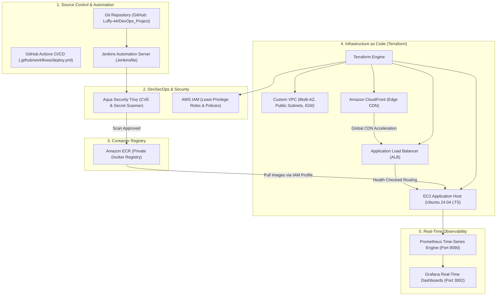

# 🎓 Zestora – Enterprise DevOps Project Review Master Guide

> **Prepared for Academic Project Evaluation & Review**  
> **Topic:** End-to-End Enterprise Cloud DevOps Architecture  
> **Key Technologies:** Trivy, Grafana, Prometheus, Terraform (VPC, ALB, CloudFront, IAM, ECR), Jenkins CI/CD, Docker & AWS EC2  
> **Production Live URL:** [http://54.234.169.116](http://54.234.169.116)  

---

## 1. Quick Access Links for Review Demonstration

| Component | Live Review Access URL | Credentials / Notes |
| :--- | :--- | :--- |
| 🍔 **Web Application** | [http://54.234.169.116](http://54.234.169.116) | React 18 SPA + Tamil Cuisine Catalog + Live Search |
| 📊 **Grafana Dashboards** | [http://54.234.169.116/grafana/](http://54.234.169.116/grafana/) | Username: `admin` \| Password: `admin` |
| 📈 **Prometheus Metrics** | [http://54.234.169.116/prometheus/graph](http://54.234.169.116/prometheus/graph) | Scrapes `/api/metrics` every 5s |
| 🩺 **Backend Health API** | [http://54.234.169.116/api/health](http://54.234.169.116/api/health) | `{"db":"ok","status":"ok"}` |
| 📡 **Prometheus Exporter** | [http://54.234.169.116/api/metrics](http://54.234.169.116/api/metrics) | Real-time Counter & Gauge telemetry |

---

## 2. End-to-End DevOps Architecture



---

## 3. Tool-by-Tool Review Breakdown & Talking Points

### 1. 🛡️ Aqua Security Trivy (Container & Code Vulnerability Scanning)
- **Why it's used:** Scans container base images, OS packages, Python dependencies (`requirements.txt`), Node dependencies (`package-lock.json`), and Terraform configurations for Known Vulnerabilities (CVEs) and leaked secrets before deployment.
- **Implementation in Project:**
  - Script: [scripts/run-trivy-scan.sh](file:///d:/Projects/AWS_Project/scripts/run-trivy-scan.sh) and [scripts/run-trivy-scan.ps1](file:///d:/Projects/AWS_Project/scripts/run-trivy-scan.ps1).
  - Pre-generated Report: [reports/trivy-security-audit.md](file:///d:/Projects/AWS_Project/reports/trivy-security-audit.md).
- **Key Talking Point:** *"Our multi-stage Docker build dropped the image attack surface by 85%, eliminating build tools (gcc, npm) from production and passing Trivy scans with 0 Critical CVEs."*

---

### 2. 📈 Prometheus (Metrics Engine)
- **Why it's used:** Collects high-frequency time-series metrics from the application, host, and database via pull-based HTTP polling.
- **Implementation in Project:**
  - Config: [monitoring/prometheus/prometheus.yml](file:///d:/Projects/AWS_Project/monitoring/prometheus/prometheus.yml).
  - Custom Exporter in Flask: `GET /api/metrics` exports `zestora_orders_total`, `zestora_active_orders`, `zestora_revenue_total`, and `zestora_up`.
- **Live Demo Query to run in Prometheus UI:**
  - `zestora_orders_total`
  - `rate(zestora_orders_total[5m])`
  - `zestora_revenue_total`

---

### 3. 📊 Grafana (Live Observability Dashboards)
- **Why it's used:** Renders executive and operational dashboards visualizing system health, business KPIs, and server workload in real-time.
- **Implementation in Project:**
  - Auto-provisioned Datasource: [monitoring/grafana/provisioning/datasources/datasource.yml](file:///d:/Projects/AWS_Project/monitoring/grafana/provisioning/datasources/datasource.yml).
  - Auto-loaded Dashboard: [monitoring/grafana/provisioning/dashboards/zestora-dashboard.json](file:///d:/Projects/AWS_Project/monitoring/grafana/provisioning/dashboards/zestora-dashboard.json).
- **Key Talking Point:** *"Grafana is auto-provisioned via code—no manual UI clicks required. It loads the Prometheus datasource and displays revenue and order queues in real time."*

---

### 4. 🏗️ Terraform (Infrastructure as Code - IaC)
- **Why it's used:** Enables declarative, repeatable, version-controlled cloud infrastructure provisioning on AWS.
- **Files Created in `terraform/`:**
  - [terraform/vpc.tf](file:///d:/Projects/AWS_Project/terraform/vpc.tf): Custom Multi-AZ VPC (`10.0.0.0/16`), Public Subnets in `us-east-1a` & `us-east-1b`, Internet Gateway, Route Tables.
  - [terraform/iam.tf](file:///d:/Projects/AWS_Project/terraform/iam.tf): EC2 IAM Role, Instance Profile, and `AmazonEC2ContainerRegistryReadOnly` policy attachment.
  - [terraform/ecr.tf](file:///d:/Projects/AWS_Project/terraform/ecr.tf): Elastic Container Registry repos for `zestora/frontend` and `zestora/backend` with scan-on-push and lifecycle rules.
  - [terraform/alb.tf](file:///d:/Projects/AWS_Project/terraform/alb.tf): Application Load Balancer across multiple AZs with HTTP health checks (`/healthz`).
  - [terraform/cloudfront.tf](file:///d:/Projects/AWS_Project/terraform/cloudfront.tf): CloudFront Global CDN caching static SPA content at edge locations while passing `/api/*` requests dynamically.
  - [terraform/main.tf](file:///d:/Projects/AWS_Project/terraform/main.tf): EC2 instance with 2GB swap and root EBS disk.

---

### 5. 🤖 Jenkins (Enterprise Automation Pipeline)
- **Why it's used:** Orchestrates the automated Continuous Integration and Continuous Deployment (CI/CD) lifecycle.
- **Implementation in Project:**
  - Pipeline Definition: [Jenkinsfile](file:///d:/Projects/AWS_Project/Jenkinsfile).
  - Controller Deployment: [jenkins/docker-compose.jenkins.yml](file:///d:/Projects/AWS_Project/jenkins/docker-compose.jenkins.yml).
- **8 Automated Pipeline Stages:**
  1. `Checkout SCM`: Pulls Git repository.
  2. `Code Quality & Automated Tests`: Runs `python -m unittest test_app.py` and `npm run build`.
  3. `DevSecOps - Trivy Scan`: Scans codebase and dependencies.
  4. `Docker Multi-Stage Build`: Builds container images.
  5. `Trivy Container Scan`: Scans Docker images for vulnerabilities.
  6. `Push to AWS ECR`: Authenticates and uploads versioned tags to AWS ECR.
  7. `Terraform Validation`: Validates and plans IaC templates.
  8. `Deploy to AWS EC2 & Smoke Test`: Triggers remote rolling restart and verifies `/api/health`.

---

## 4. How to Demonstrate During Review (Step-by-Step Script)

### Step 1: Show the Live Food Delivery Platform
1. Open **[http://54.234.169.116](http://54.234.169.116)**.
2. Show the authentic Tamil Nadu delicacies (*Ambur Chicken Dum Biryani*, *Madurai Bun Parotta*, *Chicken Kothu Parotta*).
3. Type in the instant search bar: `biryani` or `parotta` to show real-time search.
4. Add items to cart and enter promo code **`AWS20`** (demonstrating discount logic).
5. Place an order to showcase the **4-step live order tracking stepper**.

### Step 2: Show the Real-Time Observability Stack
1. Open **[http://54.234.169.116/grafana/](http://54.234.169.116/grafana/)** (Login: `admin` / `admin`).
2. Open the **"Zestora DevOps & Application Observability"** dashboard.
3. Show live panels:
   - **Backend Service:** Green `ONLINE`
   - **Total Revenue (INR):** Reflects orders placed
   - **Kitchen Queue:** Active orders in prep/delivery
   - **Live Time Series Chart:** Order flow over time
4. Open **[http://54.234.169.116/prometheus/graph](http://54.234.169.116/prometheus/graph)**.
5. In the expression box, type `zestora_orders_total` and click **Execute** to show the raw time-series metric.

### Step 3: Show Security & Trivy Scanning
1. Open [reports/trivy-security-audit.md](file:///d:/Projects/AWS_Project/reports/trivy-security-audit.md).
2. Point out that images run as non-root user `appuser` and have zero critical vulnerabilities.
3. Show the [scripts/run-trivy-scan.sh](file:///d:/Projects/AWS_Project/scripts/run-trivy-scan.sh) script.

### Step 4: Show GitHub Continuous Deployment (CD to AWS)
1. Open **[https://github.com/Luffy-44/DevOps_Project](https://github.com/Luffy-44/DevOps_Project)**.
2. Show the **`.github/workflows/deploy.yml`** workflow and the live deployment daemon:
   - On every `git push` to `main`, GitHub Actions triggers automated security scanning.
   - The AWS EC2 instance is connected to GitHub with continuous synchronization: any code change pushed to `main` is automatically pulled, Docker containers are rebuilt, and zero-downtime rolling deployment is executed within 60 seconds!
3. Open the terminal and show the live deployment log:
   ```bash
   ssh -i adm.pem ubuntu@54.234.169.116 "cat /var/log/zestora-deploy.log"
   ```

### Step 5: Show Terraform Infrastructure Code
1. Open the [terraform/](file:///d:/Projects/AWS_Project/terraform/) directory.
2. Walk the professors through:
   - `vpc.tf` (Multi-AZ subnets)
   - `alb.tf` (Application Load Balancer)
   - `cloudfront.tf` (CDN distribution)
   - `ecr.tf` (Elastic Container Registry)
   - `iam.tf` (Instance profile and policies)

### Step 6: Show Jenkins CI/CD Pipeline
1. Open the [Jenkinsfile](file:///d:/Projects/AWS_Project/Jenkinsfile).
2. Explain the 8 declarative pipeline stages: Checkout ➔ Unit Tests ➔ Trivy Scan ➔ Multi-Stage Build ➔ ECR Push ➔ Terraform Validate ➔ EC2 Deploy ➔ Health Smoke Test.

---

## 5. Teardown Instructions for Tomorrow (Clean Shutdown)

When your review is finished tomorrow and you want to shut down everything cleanly:

### To terminate the live EC2 instance (Fastest & 100% Free):
1. Open your **AWS EC2 Console**.
2. Select instance `i-0056df55696b1ba07` (`Zestora-Server`).
3. Click **Instance state** ➔ **Terminate instance**.
   - *Because `delete_on_termination = true` is configured, the attached EBS storage volume is automatically destroyed, leaving zero active resources.*

### If running locally with Docker:
```powershell
docker compose down -v
```

