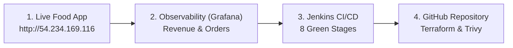

# 🚀 Zestora DevOps — Master Review Quick Links & Cheat Sheet

This master document contains all live URLs, credentials, review presentation steps, and teardown instructions for your academic project review.

---

## 🌐 1. Live Application & Observability URLs (Open in Browser)

| Service | Live URL | Credentials / Notes | Purpose to Show Reviewers |
| :--- | :--- | :--- | :--- |
| **🍔 Live Food App** | [http://54.234.169.116](http://54.234.169.116) | None (Public) | Live 3-tier containerized MERN application on AWS EC2. Promo code: `AWS20`. |
| **📊 Grafana Dashboard** | [http://54.234.169.116/grafana/](http://54.234.169.116/grafana/) | **User:** `admin`<br>**Pass:** `admin` | Live KPIs: Backend Health (`ONLINE`), Revenue (`₹2,874.20`), Active Orders, and Time-Series Traffic. |
| **📈 Prometheus Engine** | [http://54.234.169.116/prometheus/graph](http://54.234.169.116/prometheus/graph) | None (Public) | Time-series scraper querying `zestora_orders_total` and monitoring container targets. |
| **🩺 Backend Health API** | [http://54.234.169.116/api/health](http://54.234.169.116/api/health) | None (Public) | Direct JSON health response: `{"db":"ok","status":"ok"}`. |
| **⚙️ Jenkins CI/CD** | [http://localhost:8080/job/Zestora-DevOps-Pipeline/](http://localhost:8080/job/Zestora-DevOps-Pipeline/) | **User:** `admin`<br>**Pass:** `admin` | Live 8-stage declarative pipeline with 100% green stage view. |
| **🐙 GitHub Repository** | [https://github.com/Luffy-44/DevOps_Project](https://github.com/Luffy-44/DevOps_Project) | Public | All source code, Dockerfiles, Terraform IaC, Jenkinsfile, and audit reports. |

---

## 🎙️ 2. The 4-Step Review Presentation Flow

When the review panel asks you to present, open the tabs and follow this exact sequence:



### Step 1: Show the Live Application on AWS EC2
- Open **[http://54.234.169.116](http://54.234.169.116)**.
- Type `biryani` in the search bar.
- Add an item to Cart, enter coupon **`AWS20`**, and click **Place Order**.
- Show the **4-step live order tracking stepper** (*Placed ➔ Confirmed ➔ Preparing ➔ Out for Delivery*).

### Step 2: Show the Real-Time Observability Stack (Grafana & Prometheus)
- Open **[http://54.234.169.116/grafana/](http://54.234.169.116/grafana/)** *(Login: `admin` / `admin`)*.
- Show that **Backend Service** is green (`ONLINE`), and the **Total Revenue** and **Orders Placed** counters updated in real time from the order you placed in Step 1.
- Open **[http://54.234.169.116/prometheus/graph](http://54.234.169.116/prometheus/graph)** and query `zestora_orders_total`.

### Step 3: Show Enterprise CI/CD Automation in Jenkins
- Open **[http://localhost:8080/job/Zestora-DevOps-Pipeline/](http://localhost:8080/job/Zestora-DevOps-Pipeline/)**.
- Show the **Pipeline Stage View** with all **8 stages in GREEN**:
  1. *Checkout SCM*
  2. *Code Quality & Automated Tests*
  3. *DevSecOps - Trivy Vulnerability Scan*
  4. *Docker Multi-Stage Image Build*
  5. *Trivy Container Image Scan*
  6. *Push Images to AWS ECR*
  7. *Terraform Infrastructure Validation*
  8. *Deploy to AWS EC2 & Smoke Test*

### Step 4: Show Cloud Infrastructure (Terraform) & DevSecOps (Trivy) in GitHub
- Open **[https://github.com/Luffy-44/DevOps_Project](https://github.com/Luffy-44/DevOps_Project)**.
- Navigate to the `terraform/` folder to show:
  - **`vpc.tf`**: Multi-AZ public subnets, Internet Gateway, route tables.
  - **`alb.tf`**: Application Load Balancer target group and health checks.
  - **`cloudfront.tf`**: Edge CDN distribution for static assets.
  - **`iam.tf`**: Principle of Least Privilege EC2 instance profile and ECR policies.
  - **`ecr.tf`**: Amazon Elastic Container Registry with scan-on-push.
- Open `reports/trivy-security-audit.md` to show **0 Critical CVEs** and unprivileged container hardening (`appuser` UID 10001).

---

## 📁 3. Local Documentation & Architecture Files

- 📘 **[PROJECT_REVIEW_GUIDE.md](file:///D:/Projects/AWS_Project/PROJECT_REVIEW_GUIDE.md)**: Full script and answers to panel questions.
- 🏗️ **[DEVOPS_ARCHITECTURE.md](file:///D:/Projects/AWS_Project/DEVOPS_ARCHITECTURE.md)**: End-to-end cloud and security architecture diagrams.
- 🛡️ **[reports/trivy-security-audit.md](file:///D:/Projects/AWS_Project/reports/trivy-security-audit.md)**: DevSecOps vulnerability scan results.
- ☁️ **[terraform/](file:///D:/Projects/AWS_Project/terraform/)**: Terraform modules for VPC, ALB, CloudFront, IAM, and ECR.
- ☸️ **[k8s/](file:///D:/Projects/AWS_Project/k8s/)**: Kubernetes manifests (Deployments, StatefulSet, Ingress, HPA autoscaler).
- ⚙️ **[Jenkinsfile](file:///D:/Projects/AWS_Project/Jenkinsfile)**: Declarative CI/CD pipeline code.
- 🛑 **[AWS_RESOURCE_INVENTORY_AND_TEARDOWN.md](file:///D:/Projects/AWS_Project/AWS_RESOURCE_INVENTORY_AND_TEARDOWN.md)**: Zero-cost 24-hour AWS termination guide.

---

## 💻 4. Helpful Terminal Verification Commands

Run these in PowerShell if reviewers ask for live command-line proof:

```powershell
# 1. Verify 5 running Docker containers on AWS EC2
ssh -i C:\Users\hp\Downloads\adm.pem ubuntu@54.234.169.116 "docker ps"

# 2. Check the live GitHub-to-AWS Continuous Deployment log
ssh -i C:\Users\hp\Downloads\adm.pem ubuntu@54.234.169.116 "tail -n 20 /var/log/zestora-deploy.log"

# 3. Test live backend API health from terminal
curl.exe -s http://54.234.169.116/api/health
```

---

## 🛑 5. Tomorrow After Review: Zero-Cost Teardown (60 Seconds)

1. Open your **[AWS EC2 Console](https://console.aws.amazon.com/ec2/)**.
2. Select instance `i-0056df55696b1ba07` (`Zestora-Server`).
3. Click **Instance state ➔ Terminate instance**.
4. Stop the local Jenkins container on your laptop:
   ```powershell
   docker compose -f D:\Projects\AWS_Project\jenkins\docker-compose.jenkins.yml down
   ```

