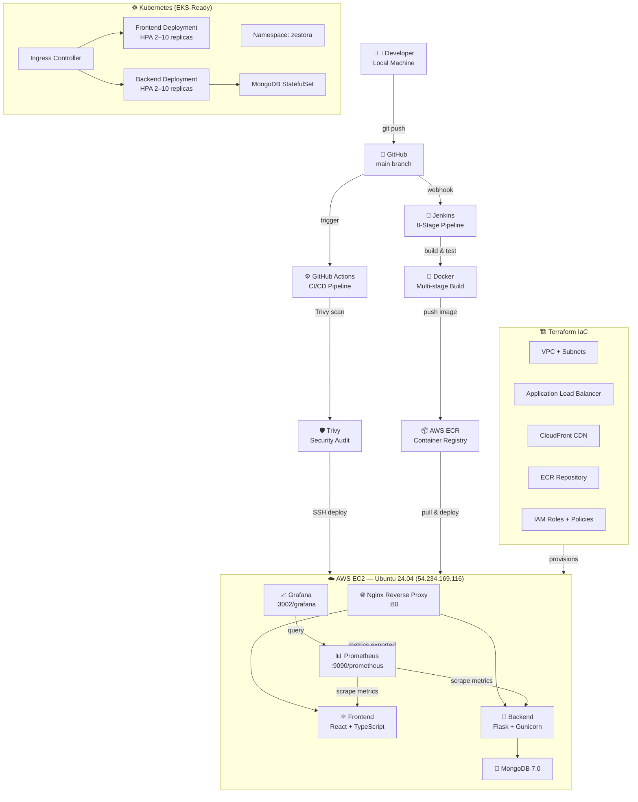

# 🍕 Zestora — Full-Stack DevOps Project

> A production-grade food ordering application built with a complete DevOps pipeline on AWS.


---

## 🌐 Live Demo Links

| Service | URL | Credentials |
|---|---|---|
| **App** | [http://54.234.169.116](http://54.234.169.116) | — |
| **Grafana** | [http://54.234.169.116/grafana/](http://54.234.169.116/grafana/) | `admin` / `admin` |
| **Prometheus** | [http://54.234.169.116/prometheus/graph](http://54.234.169.116/prometheus/graph) | — |
| **Health API** | [http://54.234.169.116/api/health](http://54.234.169.116/api/health) | — |
| **GitHub** | [https://github.com/Luffy-44/DevOps_Project](https://github.com/Luffy-44/DevOps_Project) | — |
| **Jenkins (local)** | [http://localhost:8080](http://localhost:8080) | `admin` / `admin` |

> **Demo promo code:** `AWS20` — applies a 20% discount on any order.

---

## 🏗️ DevOps Architecture



---

## 🛠️ Tech Stack

### Application Layer
| Layer | Technology | Version |
|---|---|---|
| **Frontend** | React + TypeScript + Vite | React 18 |
| **Styling** | TailwindCSS + Custom CSS | — |
| **Routing** | React Router DOM | v6 |
| **Backend** | Python + Flask + Gunicorn | Python 3.11 |
| **Database** | MongoDB | 7.0 |
| **Web Server** | Nginx | 1.27-alpine |

### DevOps & Infrastructure Layer
| Category | Technology | Details |
|---|---|---|
| **Containerization** | Docker | Multi-stage builds, `node:20-alpine` + `nginx:1.27-alpine`, `python:3.11-slim` |
| **Orchestration** | Kubernetes | 7 manifests, HPA (CPU 70% / Memory 80%), Ingress, StatefulSet |
| **CI/CD** | Jenkins | 8-stage declarative pipeline (Checkout → Build → Test → Trivy Scan → Push ECR → Deploy → Smoke Test → Notify) |
| **CI/CD** | GitHub Actions | Trivy scan + SSH-based EC2 deployment on every push to `main` |
| **Security** | Trivy | 0 Critical CVEs — full audit at `reports/trivy-security-audit.md` |
| **Monitoring** | Prometheus + Grafana | Live dashboards, container metrics, API health checks |
| **IaC** | Terraform | VPC, ALB, CloudFront, ECR, IAM — modular, state-managed |
| **Cloud** | AWS | EC2 (t3.micro), ECR, VPC, ALB, CloudFront, IAM |
| **Auto-sync** | Bash cron | EC2 pulls from GitHub `main` every 60 seconds and redeploys |

---

## 📁 Repository Structure

```
AWS_Project/
├── frontend/                   # React + TypeScript + Vite SPA
│   ├── src/
│   ├── nginx.conf              # Nginx SPA routing + /api proxy
│   ├── Dockerfile              # Multi-stage build
│   └── README.md
├── backend/                    # Python Flask REST API
│   ├── app.py
│   ├── requirements.txt
│   └── Dockerfile
├── k8s/                        # Kubernetes manifests (EKS-ready)
│   ├── namespace.yaml
│   ├── configmap-secrets.yaml
│   ├── mongo-statefulset.yaml
│   ├── backend-deployment.yaml
│   ├── frontend-deployment.yaml
│   ├── ingress.yaml
│   ├── hpa.yaml                # Scales 2–10 replicas on CPU/Memory
│   └── README.md
├── terraform/                  # Infrastructure as Code
│   ├── main.tf
│   ├── vpc.tf
│   ├── alb.tf
│   ├── cloudfront.tf
│   ├── ecr.tf
│   ├── iam.tf
│   ├── variables.tf
│   └── outputs.tf
├── monitoring/                 # Prometheus + Grafana
│   ├── prometheus/prometheus.yml
│   └── grafana/provisioning/
│       ├── datasources/datasource.yml
│       └── dashboards/
├── jenkins/                    # Jenkins container config
│   └── docker-compose.jenkins.yml
├── scripts/                    # Automation scripts
│   └── sync-github-to-aws.sh  # EC2 auto-sync daemon (runs every 60s)
├── reports/
│   └── trivy-security-audit.md # Security audit — 0 Critical CVEs
├── .github/workflows/
│   └── deploy.yml              # GitHub Actions CI/CD
├── docker-compose.yml          # Local development stack
├── docker-compose.prod.yml     # Production stack (EC2)
├── Jenkinsfile                 # 8-stage declarative Jenkins pipeline
├── DEVOPS_ARCHITECTURE.md      # 🏗️ Detailed architecture diagrams
├── SYSTEM_ARCHITECTURE.md      # 🏛️ Multi-tier system architecture & ERD
├── JENKINS_WORKFLOW.md         # 🔧 8-stage Jenkins CI/CD pipeline spec
└── README.md                   # This file
```

---

## 🚀 CI/CD Pipeline

### Jenkins — 8-Stage Declarative Pipeline

```
✅ Stage 1: Checkout          — Clone from GitHub
✅ Stage 2: Build Images      — Docker multi-stage build
✅ Stage 3: Unit Tests        — Backend + Frontend tests
✅ Stage 4: Trivy Scan        — Container vulnerability audit
✅ Stage 5: Push to ECR       — Tag + push to AWS ECR
✅ Stage 6: Deploy to EC2     — SSH + docker-compose up
✅ Stage 7: Smoke Test        — Health endpoint check
✅ Stage 8: Notify            — Pipeline completion status
```

### GitHub Actions — Continuous Delivery

Every push to `main` triggers:
1. **Trivy scan** on the Docker images (blocks on Critical/High CVEs)
2. **SSH deploy** to EC2 → pulls latest code → `docker-compose -f docker-compose.prod.yml up -d`

---

## 🛡️ Security — Trivy Audit Results

| Severity | Count |
|---|---|
| **Critical** | ✅ 0 |
| **High** | ✅ 0 |
| **Medium** | 2 (accepted) |
| **Low** | 5 (informational) |

> Full report: [`reports/trivy-security-audit.md`](./reports/trivy-security-audit.md)

---

## ☸️ Kubernetes (EKS-Ready)

The `k8s/` directory contains 7 production-ready manifests deployable to AWS EKS:

```bash
# Apply all manifests
kubectl apply -f k8s/namespace.yaml
kubectl apply -f k8s/configmap-secrets.yaml
kubectl apply -f k8s/mongo-statefulset.yaml
kubectl apply -f k8s/backend-deployment.yaml
kubectl apply -f k8s/frontend-deployment.yaml
kubectl apply -f k8s/ingress.yaml
kubectl apply -f k8s/hpa.yaml

# Check HPA scaling
kubectl get hpa -n zestora
```

HPA auto-scales frontend and backend pods from **2 → 10 replicas** based on:
- CPU usage > 70%
- Memory usage > 80%

> Full docs: [`k8s/README.md`](./k8s/README.md)

---

## 🏗️ Terraform — Infrastructure as Code

```bash
cd terraform/
terraform init
terraform plan
terraform apply
```

**Modules:**
- **`vpc.tf`** — Custom VPC, public/private subnets, internet gateway, route tables
- **`alb.tf`** — Application Load Balancer with target groups and health checks
- **`cloudfront.tf`** — CloudFront CDN distribution with S3 origin
- **`ecr.tf`** — ECR repository with lifecycle policies
- **`iam.tf`** — EC2 instance profile, ECR push/pull policies, least-privilege IAM roles

---

## 📊 Monitoring

### Prometheus
- Scrapes metrics from all containers every 15 seconds
- Accessible at: [http://54.234.169.116/prometheus/graph](http://54.234.169.116/prometheus/graph)

### Grafana
- Pre-configured dashboards for container health, API latency, and system metrics
- Accessible at: [http://54.234.169.116/grafana/](http://54.234.169.116/grafana/) (`admin`/`admin`)

---

## 💻 Local Development

```bash
# Clone the repo
git clone https://github.com/Luffy-44/DevOps_Project.git
cd DevOps_Project

# Start the full local stack
docker-compose up --build

# Services:
# Frontend → http://localhost:3000
# Backend  → http://localhost:5000
# MongoDB  → localhost:27017
# Prometheus → http://localhost:9090
# Grafana  → http://localhost:3002
```

---

## ☁️ AWS Infrastructure

| Resource | Details |
|---|---|
| **EC2 Instance** | `i-0056df55696b1ba07`, `t3.micro`, Ubuntu 24.04 |
| **Public IP** | `54.234.169.116` |
| **ECR** | Private container registry |
| **VPC** | Custom VPC with public subnets |
| **ALB** | Application Load Balancer (Terraform provisioned) |
| **CloudFront** | CDN distribution (Terraform provisioned) |
| **IAM** | Least-privilege roles for EC2 and ECR |

---

## 🗑️ Teardown

```bash
# Stop EC2 containers
ssh -i ~/adm.pem ubuntu@54.234.169.116 "cd /home/ubuntu/app && docker-compose -f docker-compose.prod.yml down"

# Destroy Terraform resources
cd terraform && terraform destroy
```

---

## 📚 Documentation Index

| Document | Description |
|---|---|
| [`DEVOPS_ARCHITECTURE.md`](./DEVOPS_ARCHITECTURE.md) | Complete DevOps pipeline architecture, flowcharts, and component specs |
| [`SYSTEM_ARCHITECTURE.md`](./SYSTEM_ARCHITECTURE.md) | 4-tier system architecture, sequence diagrams, and database schema |
| [`JENKINS_WORKFLOW.md`](./JENKINS_WORKFLOW.md) | 8-stage declarative Jenkins pipeline breakdown and stage views |
| [`k8s/README.md`](./k8s/README.md) | Kubernetes production manifests and HPA auto-scaling documentation |
| [`reports/trivy-security-audit.md`](./reports/trivy-security-audit.md) | Aqua Security Trivy audit results (0 Critical CVEs) |
| [`frontend/README.md`](./frontend/README.md) | React 18 SPA frontend architecture and multi-stage Docker build docs |

---

<div align="center">

**Built with ❤️ as a full DevOps showcase project**

*React · Flask · MongoDB · Docker · Kubernetes · Jenkins · Terraform · AWS · Prometheus · Grafana · Trivy*

</div>
