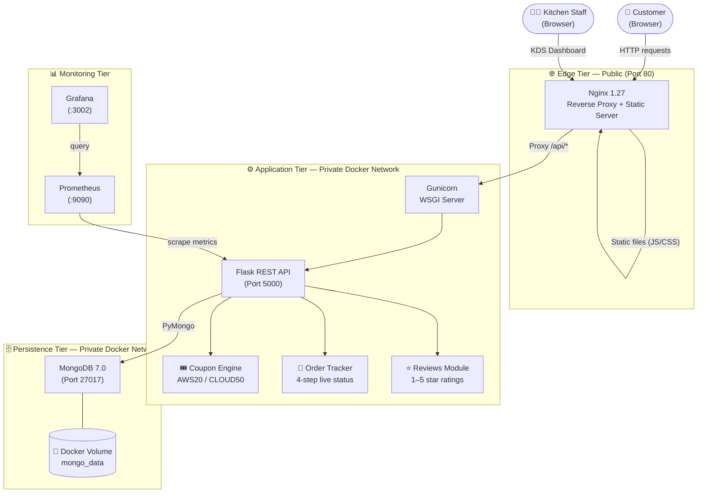
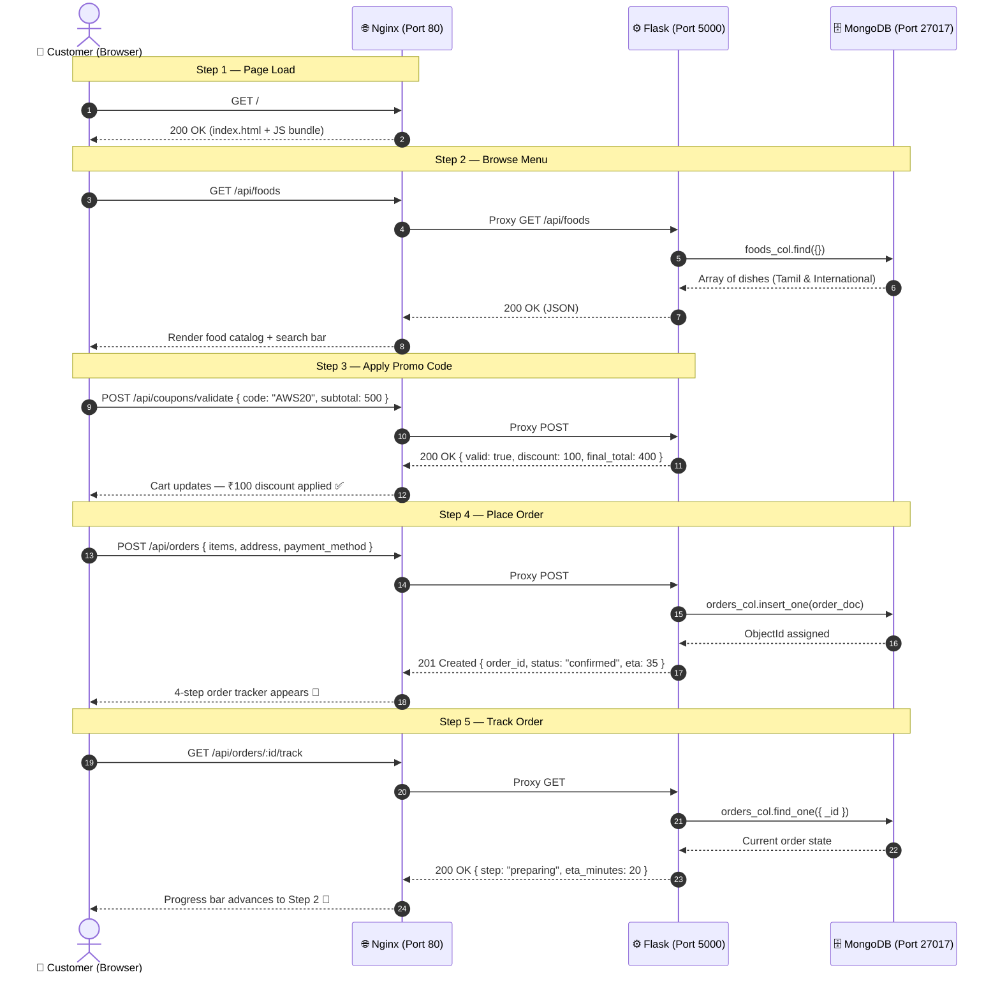
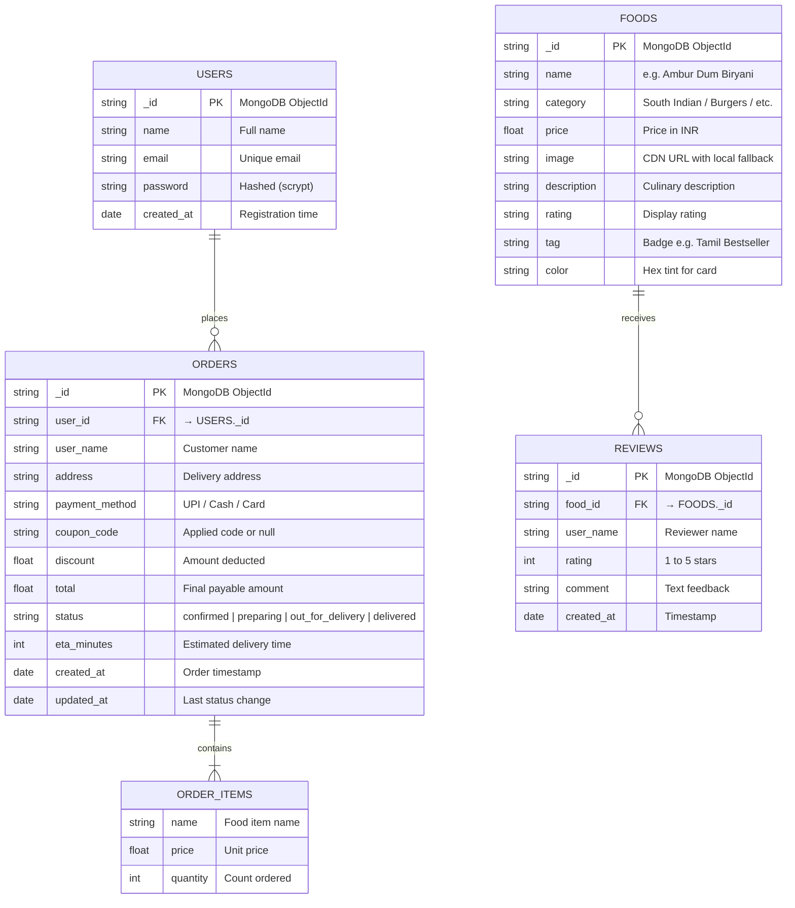
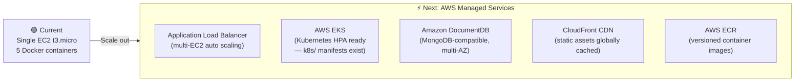

# 🏛️ Zestora — System Architecture

> A structured, visual breakdown of every layer of the Zestora food ordering platform — from the browser to the database, and from local Docker to AWS cloud.

---

## 📐 Table of Contents

1. [Architecture at a Glance](#1-architecture-at-a-glance)
2. [The 4 Tiers Explained](#2-the-4-tiers-explained)
   - [Client Tier — React SPA](#21-client-tier--react-spa)
   - [Edge Tier — Nginx](#22-edge-tier--nginx)
   - [Application Tier — Flask API](#23-application-tier--flask-api)
   - [Persistence Tier — MongoDB](#24-persistence-tier--mongodb)
3. [Request Flow — Step by Step](#3-request-flow--step-by-step)
4. [Database Schema](#4-database-schema)
5. [Security Architecture](#5-security-architecture)
6. [Container Network Map](#6-container-network-map)
7. [Scalability Roadmap](#7-scalability-roadmap)

---

## 1. Architecture at a Glance

Zestora is a **4-tier containerized web application** running on AWS EC2. Each tier lives in its own Docker container, communicating over a private internal Docker network (`zestora_net`). Only Nginx is exposed to the public internet.



---

## 2. The 4 Tiers Explained

---

### 2.1 Client Tier — React SPA

> What the user sees and interacts with in their browser.

| Property | Detail |
|---|---|
| **Framework** | React 18 + TypeScript |
| **Build Tool** | Vite 5 (outputs optimized `dist/` bundle) |
| **Routing** | React Router DOM v6 (client-side, no page reloads) |
| **Styling** | TailwindCSS + custom CSS |
| **State** | React hooks — `useState`, `useEffect`, `useMemo`, `useCallback` |

**Key Features:**

| Feature | How it works |
|---|---|
| 🔍 **Instant Search** | Debounced input filters dishes by name, category, description, and tag in real-time |
| 🛒 **Cart Management** | Optimistic UI updates — no page reload needed when adding/removing items |
| 🎟️ **Promo Codes** | Enter `AWS20` → 20% off applied instantly with real-time subtotal recalculation |
| 📍 **Order Tracker** | 4-step progress bar: `Confirmed → Kitchen Preparing → Out for Delivery → Delivered` |
| 👨‍🍳 **Kitchen Dashboard (KDS)** | Staff view: incoming tickets, revenue metrics, fulfillment state updates |
| ⭐ **Reviews** | 1–5 star rating modal per dish, submitted to the backend API |

---

### 2.2 Edge Tier — Nginx

> The gatekeeper. All public internet traffic hits Nginx first.

| Property | Detail |
|---|---|
| **Image** | `nginx:1.27-alpine` (~25 MB) |
| **Port** | `80` (public) |
| **Config file** | `frontend/nginx.conf` |

**Responsibilities:**

```
┌─────────────────────────────────────────────────────────┐
│                       NGINX ROUTER                       │
│                                                         │
│   GET /               → serve dist/index.html           │
│   GET /assets/*       → serve JS/CSS (1-year cache)     │
│   GET /api/*          → proxy → backend:5000            │
│   GET /prometheus/*   → proxy → prometheus:9090         │
│   GET /grafana/*      → proxy → grafana:3002            │
│   Any unknown route   → fallback to index.html (SPA)    │
└─────────────────────────────────────────────────────────┘
```

**Security headers Nginx adds to every response:**
```nginx
X-Frame-Options: SAMEORIGIN
X-Content-Type-Options: nosniff
X-XSS-Protection: 1; mode=block
Referrer-Policy: strict-origin-when-cross-origin
Cache-Control: no-cache (for index.html only)
```

---

### 2.3 Application Tier — Flask API

> The brain. Handles all business logic, validation, and database operations.

| Property | Detail |
|---|---|
| **Language** | Python 3.11 |
| **Framework** | Flask |
| **WSGI Server** | Gunicorn (multi-threaded workers) |
| **Port** | `5000` (internal only — never exposed publicly) |
| **Auth** | Stateless JWT (HMAC-SHA256), passwords hashed with `scrypt` |

**API Endpoints:**

| Method | Endpoint | Description | Response |
|---|---|---|---|
| `GET` | `/api/health` | Service health check | `{"status":"ok","db":"ok"}` |
| `GET` | `/api/foods` | Fetch all menu items | `200 OK` — JSON array |
| `POST` | `/api/orders` | Place a new order | `201 Created` — order ID + status |
| `GET` | `/api/orders/:id/track` | Live order status | `200 OK` — steps + ETA |
| `POST` | `/api/coupons/validate` | Validate promo code | `200 OK` — discount amount |
| `POST` | `/api/reviews` | Submit a food review | `201 Created` |

**HTTP Status Code Convention:**

| Code | Meaning |
|---|---|
| `200` | Successful retrieval or update |
| `201` | Resource created (order, review) |
| `400` | Bad request — validation failure or invalid coupon |
| `401` | Unauthorized — missing or invalid JWT |
| `404` | Not found — unknown order ID or food item |

---

### 2.4 Persistence Tier — MongoDB

> The data store. Completely hidden from the public internet.

| Property | Detail |
|---|---|
| **Engine** | MongoDB 7.0 Community |
| **Port** | `27017` (internal Docker network only) |
| **Storage** | Docker named volume `mongo_data` (backed by EBS gp3 on EC2) |
| **Access** | Only reachable by the Flask backend within `zestora_net` |
| **Collections** | `users`, `foods`, `orders`, `reviews` |

> ⚠️ Port 27017 is **never** exposed to the host or the public internet. It is bound strictly to the internal Docker bridge network.

---

## 3. Request Flow — Step by Step

The following sequence covers the full customer journey from landing on the site to tracking their order.



---

## 4. Database Schema



---

## 5. Security Architecture

```
┌──────────────────────────────────────────────────────────────────────┐
│                        SECURITY LAYERS                               │
│                                                                      │
│  🌐 NETWORK LAYER                                                    │
│     ✅ MongoDB port 27017 — internal Docker network ONLY             │
│     ✅ Backend port 5000  — internal Docker network ONLY             │
│     ✅ Only Nginx port 80 is publicly reachable                      │
│                                                                      │
│  🛡️ DEVSECOPS — TRIVY                                               │
│     ✅ Filesystem scan (source code + dependencies) — 0 Critical     │
│     ✅ Container image scan (OS packages) — 0 Critical               │
│     📄 Full report: reports/trivy-security-audit.md                  │
│                                                                      │
│  🔐 AUTHENTICATION                                                   │
│     ✅ Stateless JWT tokens (HMAC-SHA256 signed)                     │
│     ✅ Passwords hashed with scrypt + random salt                    │
│     ✅ Backend Gunicorn runs as non-root user (appuser)              │
│                                                                      │
│  🌍 HTTP HEADERS (Nginx)                                             │
│     ✅ X-Frame-Options: SAMEORIGIN                                   │
│     ✅ X-Content-Type-Options: nosniff                               │
│     ✅ X-XSS-Protection: 1; mode=block                              │
│     ✅ Referrer-Policy: strict-origin-when-cross-origin              │
│                                                                      │
│  ☁️ AWS IAM                                                          │
│     ✅ EC2 instance profile with least-privilege ECR access          │
│     ✅ No hardcoded AWS credentials in source code                   │
└──────────────────────────────────────────────────────────────────────┘
```

---

## 6. Container Network Map

All 5 production containers run on the same Docker bridge network `zestora_net`. Only Nginx has an external port binding.

```
Internet
   │
   │ Port 80 (public)
   ▼
┌─────────────────────────────────────────────────────────┐
│               Docker Network: zestora_net                │
│                                                         │
│  ┌────────────────┐    ┌────────────────────────────┐   │
│  │   nginx:1.27   │───▶│   backend:python:3.11-slim │   │
│  │   Port 80 ✅   │    │   Port 5000 (internal)     │   │
│  │   (public)     │    └────────────┬───────────────┘   │
│  └────────────────┘                 │ PyMongo            │
│                                     ▼                   │
│                         ┌───────────────────────┐       │
│                         │   mongo:7.0           │       │
│                         │   Port 27017 (internal│       │
│                         │   + volume: mongo_data│       │
│                         └───────────────────────┘       │
│                                                         │
│  ┌────────────────┐    ┌────────────────────────────┐   │
│  │  prometheus    │───▶│   grafana                  │   │
│  │  Port 9090     │    │   Port 3002                │   │
│  │  (via /prom..) │    │   (via /grafana/)          │   │
│  └───────┬────────┘    └────────────────────────────┘   │
│          │ scrape                                        │
│          └──────▶ backend + nginx metrics               │
└─────────────────────────────────────────────────────────┘
```

**Docker Compose files:**
| File | Purpose |
|---|---|
| `docker-compose.yml` | Local development (with hot reload) |
| `docker-compose.prod.yml` | Production deployment on EC2 |
| `jenkins/docker-compose.jenkins.yml` | Jenkins container (port 8080) |

---

## 7. Scalability Roadmap

The current single-EC2 architecture can grow into a full AWS production setup:



| Current | Future Upgrade |
|---|---|
| Single EC2 | EC2 Auto Scaling Group behind ALB |
| Docker Compose | AWS EKS (Kubernetes manifests are **already written** in `k8s/`) |
| Local MongoDB container | Amazon DocumentDB or MongoDB Atlas (multi-AZ) |
| Nginx static serving | Amazon CloudFront CDN + S3 |
| Local Docker builds | AWS ECR + GitHub Actions push on merge |

---

> 📌 **Related docs:**
> [`README.md`](./README.md) · [`DEVOPS_ARCHITECTURE.md`](./DEVOPS_ARCHITECTURE.md) · [`JENKINS_WORKFLOW.md`](./JENKINS_WORKFLOW.md) · [`k8s/README.md`](./k8s/README.md)
